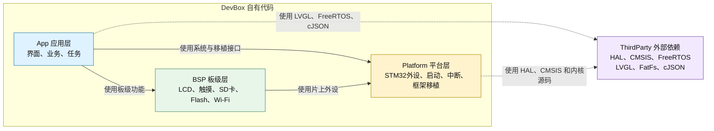

# DevBox 工程架构 V2.1（简化优化版）

> 目标：打开工程就能知道代码放哪里，不追求复杂的“完美分层”。
>
> 适用：STM32H743 + FreeRTOS + LVGL + FatFs + cJSON。

V2.1 保持四个核心代码区：

- `App`：界面、业务、任务
- `BSP`：LCD、触摸、SD、Flash、Wi-Fi
- `Platform`：STM32 初始化和框架移植
- `ThirdParty`：HAL、CMSIS、FreeRTOS、LVGL、FatFs、cJSON

## 1. 一张图看懂架构



图中实线表示 DevBox 自有代码之间的分层依赖，虚线表示对外部源码库的使用。`ThirdParty` 是外部依赖集合，不是位于 Platform 下方的传统业务层。

只需要记住下面四句话：

1. 产品功能放 `App`。
2. 板载设备驱动放 `BSP`。
3. STM32 初始化和移植代码放 `Platform`。
4. 别人维护的源码统一放 `ThirdParty`，原则上不修改。

依赖只能从上往下。底层代码不能反过来包含 `App` 的头文件。

## 2. 推荐目录

```text
devbox/
├─ App/                              # 自己的产品代码
│  ├─ Inc/
│  ├─ Src/
│  │  ├─ app_main.c                 # 应用入口和任务创建
│  │  ├─ app_gui.c                  # GUI 任务
│  │  ├─ app_network.c              # Wi-Fi、天气、时间同步
│  │  ├─ app_uart.c                 # 串口工具功能
│  │  └─ app_calendar.c             # 日历功能
│  └─ Assets/                       # 图片和字体
│
├─ BSP/                              # 当前 DevBox 板的设备驱动
│  ├─ Inc/
│  │  ├─ bsp_board.h
│  │  ├─ bsp_lcd.h
│  │  ├─ bsp_touch.h
│  │  ├─ bsp_sd.h
│  │  ├─ bsp_flash.h
│  │  └─ bsp_wifi.h
│  └─ Src/
│     ├─ bsp_board.c
│     ├─ bsp_lcd.c                  # LCD、LTDC、DMA2D
│     ├─ bsp_touch.c                # GT911
│     ├─ bsp_sd.c                   # SDMMC、SD 卡
│     ├─ bsp_flash.c                # W25Q64
│     └─ bsp_wifi.c                 # ESP8266 AT 驱动
│
├─ Platform/                         # 与 STM32H743 和框架移植有关
│  ├─ MCU/
│  │  ├─ Inc/                       # main.h、HAL 配置、外设头文件
│  │  ├─ Src/                       # 时钟、中断、GPIO、DMA、UART、RTC
│  │  └─ Startup/                   # 启动文件
│  └─ Port/
│     ├─ LVGL/                      # lv_port_disp、lv_port_indev
│     ├─ FatFs/                     # sd_diskio
│     └─ FreeRTOS/                  # FreeRTOSConfig、内存配置
│
├─ ThirdParty/                       # 外部源码，尽量保持原样
│  ├─ ST/
│  │  ├─ CMSIS/
│  │  └─ STM32H7xx_HAL_Driver/
│  ├─ FreeRTOS/
│  ├─ LVGL/
│  ├─ FatFs/
│  └─ cJSON/
│
├─ Config/
│  ├─ app_config.h                  # 普通配置
│  ├─ secrets.example.h             # 密钥配置模板
│  └─ secrets.local.h               # 真实密钥，不提交 Git
│
├─ MDK-ARM/                          # Keil 工程
├─ docs/                             # 文档
├─ project.ioc
└─ README.md
```

这里不再单独设计 Services、Components、UI、OSAL 等层。等某部分代码真正变大后，再在 `App` 或 `BSP` 内部拆子目录。

## 3. 每个目录到底放什么

| 目录 | 放什么 | 不放什么 |
|---|---|---|
| `App` | 页面、业务、FreeRTOS 任务、任务间消息、天气解析、时间同步 | HAL 初始化、GPIO 引脚操作、器件通信时序 |
| `BSP` | 当前板上的 LCD、GT911、SD、W25Q64、ESP8266、SDRAM 驱动 | LVGL 页面、天气业务、任务创建 |
| `Platform/MCU` | 时钟、中断、GPIO、DMA、UART、RTC、SDMMC、LTDC 等 STM32 初始化 | UI、网络业务、第三方库源码 |
| `Platform/Port` | LVGL、FatFs、FreeRTOS 与本项目之间的连接代码 | 第三方库本体、产品业务 |
| `ThirdParty` | ST HAL、CMSIS、FreeRTOS、LVGL、FatFs、cJSON 原始源码 | 自己写的页面、驱动和移植代码 |
| `Config` | 编译配置和本地配置模板 | 业务实现和真实密钥提交记录 |

## 4. HAL、BSP 和第三方库怎么区分

### HAL

HAL 是 ST 提供的 STM32 外设库，例如：

```text
stm32h7xx_hal_gpio.c
stm32h7xx_hal_uart.c
stm32h7xx_hal_sd.c
```

它属于第三方源码，统一放：

```text
ThirdParty/ST/STM32H7xx_HAL_Driver
```

### Platform

Platform 是本工程对 STM32H743 的具体配置，例如：

- UART6 波特率和 DMA 配置；
- GPIO 引脚初始化；
- RTC、LTDC、SDMMC 初始化；
- 系统时钟和中断函数。

这些代码放 `Platform/MCU`。

### BSP

BSP 表示“DevBox 这块板怎么使用设备”，对上提供简单接口：

```c
int bsp_lcd_init(void);
int bsp_touch_read(bsp_touch_point_t *point);
int bsp_sd_init(void);
int bsp_wifi_connect(const char *ssid, const char *password);
```

App 只调用这些接口，不直接操作 `UART_HandleTypeDef`、GPIO 或 HAL。

### 调用关系示例

```text
App 天气功能
  -> bsp_wifi_connect()
    -> Platform UART6/DMA
      -> STM32 HAL
        -> ESP8266 硬件

LVGL
  -> lv_port_disp
    -> bsp_lcd_flush()
      -> Platform LTDC/DMA2D
        -> STM32 HAL
          -> LCD 硬件
```

## 5. 第三方库统一规则

凡是“可以从官方重新下载并整体替换”的源码，都放 `ThirdParty`。

| 库 | 位置 | 自己的适配代码放哪里 |
|---|---|---|
| STM32 HAL/CMSIS | `ThirdParty/ST` | `Platform/MCU` |
| FreeRTOS | `ThirdParty/FreeRTOS` | `Platform/Port/FreeRTOS` |
| LVGL | `ThirdParty/LVGL` | `Platform/Port/LVGL` |
| FatFs | `ThirdParty/FatFs` | `Platform/Port/FatFs` |
| cJSON | `ThirdParty/cJSON` | JSON 业务处理放 `App` |

基本原则：

- 不把自己的文件放进第三方库目录；
- 不把 `lv_port_disp.c` 放在 LVGL 的 `examples` 中；
- 不把 `sd_diskio_dma.c` 混在 FatFs 原始源码中；
- 必须修改第三方源码时，记录修改原因，方便以后升级。

## 6. 当前文件怎么搬

| 当前内容 | 新位置 |
|---|---|
| `main.c` 中任务创建 | `App/Src/app_main.c` |
| `main.c` 中 GUI 循环 | `App/Src/app_gui.c` |
| `main.c` 中 ESP8266、天气、SNTP 业务 | `App/Src/app_network.c` |
| `LVGL/app/app_main.c` | `App/Src/app_gui.c` 或按页面拆分 |
| `LVGL/app/app_uart.c` | `App/Src/app_uart.c` |
| `LVGL/app/app_calendar.c` | `App/Src/app_calendar.c` |
| `LVGL/app/assets` | `App/Assets` |
| `gpio.c`、`dma.c`、`usart.c`、`rtc.c` | `Platform/MCU/Src` |
| `stm32h7xx_it.c`、MSP、系统时钟 | `Platform/MCU/Src` |
| `lcd.c`、`dma2d.c` | 整理为 `BSP/Src/bsp_lcd.c`，底层初始化留在 Platform |
| `gt911.c` | `BSP/Src/bsp_touch.c` |
| `sdmmc_sd.c` | `BSP/Src/bsp_sd.c` |
| `w25q64.c` | `BSP/Src/bsp_flash.c` |
| `esp8266.c` | `BSP/Src/bsp_wifi.c` |
| `lv_port_disp.c`、`lv_port_indev.c` | `Platform/Port/LVGL` |
| `sd_diskio_dma.c` | `Platform/Port/FatFs` |
| CMSIS、HAL、FreeRTOS、LVGL、FatFs、cJSON | `ThirdParty` 对应目录 |

## 7. main.c 应该有多简单

`main.c` 只负责启动：

```c
int main(void)
{
    HAL_Init();
    system_clock_init();
    platform_mcu_init();
    bsp_board_init();
    app_main();

    vTaskStartScheduler();

    while (1) {
        error_handler();
    }
}
```

不要再把 Wi-Fi AT 命令、天气 JSON 解析、LVGL 页面更新写在 `main.c`。

## 8. 建议的任务划分

当前阶段三个任务足够：

| 任务 | 作用 |
|---|---|
| `gui_task` | 初始化 LVGL、创建页面、调用 `lv_timer_handler()`、处理 UI 消息 |
| `network_task` | ESP8266 连接、天气请求、SNTP 同步、重连 |
| `storage_task` | 可选；文件读写较多时再创建，当前简单访问可暂不单独建任务 |

网络任务通过 Queue 把天气和时间数据发送给 GUI 任务。网络任务不要直接操作 LVGL 对象。

## 9. 实施顺序

不要一次搬完，按下面顺序改，每一步都保证能够编译运行：

1. 先创建 `App`，把任务和业务从 `main.c` 拆出去。
2. 创建 `BSP`，统一 LCD、触摸、SD、Flash、Wi-Fi 接口。
3. 把 LVGL 和 FatFs 移植文件放入 `Platform/Port`。
4. UI 去掉对 `usart.h`、`rtc.h`、HAL 头文件的直接依赖。
5. 最后再移动第三方库并更新 Keil 路径。

如果还需要频繁用 CubeMX 重新生成代码，可以暂时保留现在的 `Core` 和 `Drivers` 物理目录，把它们分别当成 `Platform/MCU` 和 `ThirdParty/ST` 使用。先把代码职责理清，再做物理搬迁。

## 10. 当前必须先检查的两件事

1. 工程使用 STM32H743 Cortex-M7，但 Keil 当前引用的是 FreeRTOS `ARM_CM4F` portable 目录，应换成与 Cortex-M7 和 ARMClang 匹配的端口。
2. 当前 `main.c` 中存在 Wi-Fi 密码和天气 API Key，应立即轮换，并改放到不提交 Git 的 `Config/secrets.local.h`。

## 11. 最终判断口诀

遇到一个文件不知道放哪里时，依次问：

```text
这是产品功能或页面吗？        -> App
这是板载设备的操作吗？        -> BSP
这是 STM32 初始化或框架适配吗？-> Platform
这是从官方拿来的源码吗？      -> ThirdParty
```

这四个答案已经足够覆盖当前工程，不需要再增加更多架构层。

